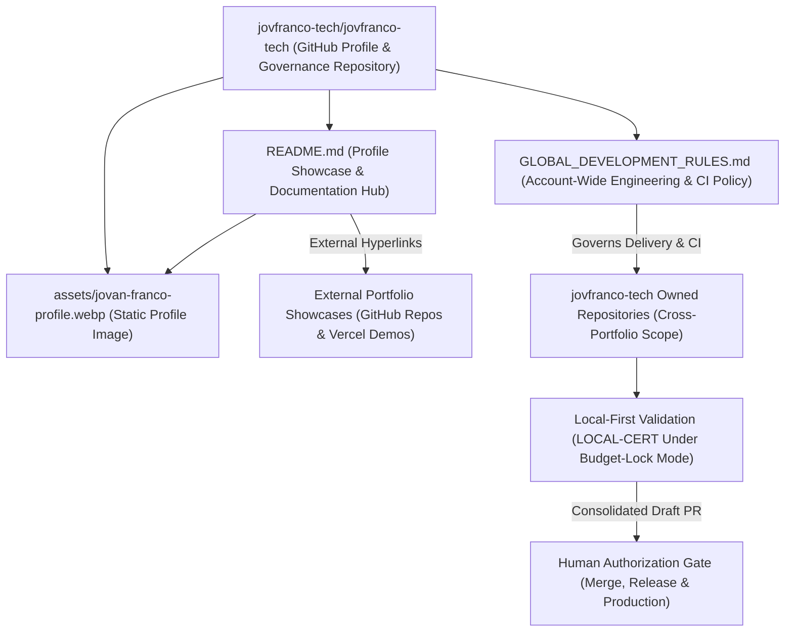

# Jovan Franco

  

  <strong>Regional Technology Transformation Leader | AI Governance, Cloud, Cybersecurity, Resilience & AI-Native Systems</strong> 
  Mexico City, Mexico • 15+ Years of Regional Technology Leadership • 16 LATAM Countries

  <a href="https://github.com/jovfranco-tech/executive-ai-it-leadership-suite-showcase"><strong>Primary Executive Portfolio</strong></a> •
  <a href="https://www.jovanfranco.com"><strong>Website & Executive Insights</strong></a> •
  <a href="https://www.linkedin.com/in/jovan-franco-6467871b/"><strong>LinkedIn</strong></a>

---

## Executive Snapshot

> [!NOTE]
> Metrics below summarize **author-declared career history and portfolio execution**, separate from the static file artifacts verified inside this repository (`README.md`, `GLOBAL_DEVELOPMENT_RULES.md`, and `assets/jovan-franco-profile.webp`).

| Evidence | Scope |
| :--- | :--- |
| **USD $5.7M+ documented professional savings** | Infrastructure, technology consolidation, workload optimization and operational efficiency across career roles |
| **16-country regional footprint** | Technology delivery and operational leadership across Latin America, coordinated with global engineering teams |
| **1,800+ hours of AI-native product execution** | Architecture, supervised agentic development, interactive systems and enterprise decision-support prototypes |
| **Governance-led delivery** | PMP®, ISO/IEC 42001 Lead Auditor, ISO 22301 Lead Auditor and Associate CCISO |

## Primary Portfolio Entry

### [Executive AI & IT Leadership Suite](https://github.com/jovfranco-tech/executive-ai-it-leadership-suite-showcase)

A unified executive portfolio showing how AI governance, agent oversight, PMO intelligence, IT operations, AI investment management and hybrid FinOps can support enterprise technology decisions.

The suite connects six public portfolio demonstrations to the operating model of **Executive Command Center**, a private-source commercial decision-support platform for technology, AI, risk, operations and portfolio leadership.

---

## Executive Profile

Senior Technology Transformation Leader with 15+ years of experience directing enterprise infrastructure, cloud architecture, cybersecurity governance, operational resilience and AI-native product systems across Latin America.

My work connects technical execution with board-level outcomes: cost optimization, risk reduction, operational stability, auditable governance and clearer investment decisions. I specialize in translating emerging AI capabilities into controlled enterprise systems with explicit ownership, evidence, human oversight and measurable business value.

---

## Selected Public Work

| Portfolio Project | What it demonstrates | Live experience |
| :--- | :--- | :--- |
| **[Executive AI & IT Leadership Suite](https://github.com/jovfranco-tech/executive-ai-it-leadership-suite-showcase)** | Executive operating model across AI governance, PMO, operations, portfolio and FinOps | Six linked public modules |
| **[AI Governance Control Tower](https://github.com/jovfranco-tech/ai-governance-control-tower-showcase)** | ISO/IEC 42001-inspired intake, risk, controls, exceptions and audit evidence | [Open demo](https://ai-governance-control-tower.vercel.app/) |
| **[AI Agent Governance Registry](https://github.com/jovfranco-tech/ai-agent-governance-registry-showcase)** | Agent ownership, permission boundaries, risk classification and human approval gates | [Open demo](https://ai-governance-registry.vercel.app/) |
| **[Agent Office World](https://github.com/jovfranco-tech/Agent-Office-World)** | Visual multi-agent operating model and deterministic organizational simulation | [Open demo](https://agent-office-world.vercel.app/) |
| **[Florería Paola Taste Lab](https://github.com/jovfranco-tech/floreria-paola-taste-lab)** | Before-and-after UX, information architecture and conversion-oriented design | [Open demo](https://floreria-paola-taste-lab.vercel.app/) |
| **[Caribbean Asteroid Twin](https://github.com/jovfranco-tech/caribbean-asteroid-twin)** | Responsible 3D geospatial storytelling and fictional command-center visualization | [Open demo](https://caribbean-asteroid-twin.vercel.app/) |

---

## Leadership & Architecture Domains

| Domain | Focus |
| :--- | :--- |
| **AI Governance & Agentic Systems** | ISO/IEC 42001, NIST AI RMF, ownership models, risk tiering, permission boundaries and human oversight |
| **Cloud Architecture & FinOps** | Azure enterprise architecture, multi-region platforms, workload optimization, cost governance and value realization |
| **Cybersecurity & Resilience** | Zero Trust, ISO 27001 / ISO 22301, operational risk, disaster recovery, continuity and SecOps governance |
| **Portfolio & Transformation Leadership** | PMP, hybrid delivery, PMO intelligence, investment prioritization and executive decision support |
| **Interactive Product Systems** | TypeScript, React, Next.js, Node.js, Three.js, Python and API-driven architectures |

---

## Selected Credentials

- **Project Management Professional (PMP®)** — Project Management Institute
- **ISO/IEC 42001 Lead Auditor** — Artificial Intelligence Management Systems
- **ISO 22301 Lead Auditor** — Business Continuity Management
- **Microsoft Certified: Azure Solutions Architect Expert**
- **Microsoft Certified: Azure AI Engineer Associate**
- **Associate CCISO** — EC-Council

---

## Responsible Portfolio Boundaries

> [!NOTE]
> Public repositories and web applications under this profile are portfolio demonstrations, architectural prototypes and decision-support models built with synthetic or representative data. They are distinct from confidential client environments, production enterprise infrastructure and proprietary commercial source repositories.

---

## Repository Architecture & Governance Scope

### Purpose & Problem Solved

`jovfranco-tech/jovfranco-tech` is a dual-purpose **GitHub Special Profile & Account Governance Repository**:

1. **Executive Profile Presentation (`README.md` + `assets/jovan-franco-profile.webp`)**: Solves portfolio fragmentation by providing a verified public entry point to architecture domains, credentials, and live synthetic-data demonstrations while clearly separating public showcases from private commercial source code.
2. **Account-Wide Engineering & CI Cost Governance ([`GLOBAL_DEVELOPMENT_RULES.md`](GLOBAL_DEVELOPMENT_RULES.md))**: Solves uncontrolled GitHub Actions execution churn, premature merges, and unverified certification signals across all repositories owned by `jovfranco-tech` by codifying isolated-branch development, consolidated Draft PRs, human-authorized release gates, `Actions budget-lock mode` (`LOCAL-CERT`), and a `>=90%` GitHub Actions execution reduction target versus the August 1–7, 2026 baseline.

### Repository Architecture

### Verified Repository Contents & Technical Stack

| Surface | Verified State in `HEAD` | Details |
| :--- | :--- | :--- |
| **Markdown Documentation** | `2` files | [`README.md`](README.md) and [`GLOBAL_DEVELOPMENT_RULES.md`](GLOBAL_DEVELOPMENT_RULES.md) |
| **Static Assets** | `1` file | [`assets/jovan-franco-profile.webp`](assets/jovan-franco-profile.webp) (`65,080` bytes) |
| **Application Source / APIs / Agent Runtime** | `0` files | Static profile and governance repository; no application runtime |
| **Package Manifests / Dependencies** | `0` files | No `package.json`, `requirements.txt`, `pyproject.toml`, or lockfiles |
| **Environment Variables** | `0` variables | No `.env` or `.env.example` files; no environment variables referenced |
| **Database & Migrations** | Not applicable | `0` schema or migration files; no persistence layer |
| **GitHub Actions Workflows** | `0` files | No `.github/workflows/` directory; renders statically on GitHub |
| **Automated Test Suites** | `0` files | No test runner or automated runtime test files present |

---

## Account-Wide Engineering & CI Governance (`GLOBAL_DEVELOPMENT_RULES.md`)

Verified capabilities codified in [`GLOBAL_DEVELOPMENT_RULES.md`](GLOBAL_DEVELOPMENT_RULES.md) (merged via PR `#3`, `c54a57c`, 2026-10-22):

- **Authority & Release Boundaries**: Isolated branches, consolidated Draft PRs, zero auto-merge, and strict separation between CI/local pass signals and human-authorized merge, release, and production actions.
- **Actions Budget-Lock Mode**: Mandatory `local-first / GitHub-CI-free` workflow whenever GitHub Actions spending limits are reached or frozen; requires `LOCAL-CERT` / local validation labeling (never mislabeled as GitHub CI certified) and exact commit/tree hash traceability.
- **12 Mandatory CI Cost Controls**: Local-first validation loop, one canonical quality workflow per repository, checkpoint-only remote CI (no CI on every Draft PR sync), mandatory `concurrency` cancellation, conservative `paths` / `paths-ignore` filtering, checkpoint-only E2E/Playwright, zero duplicate installs/builds, Linux-default economical runners with `timeout-minutes`, removal of unnecessary cron schedules, targeted job retries, legacy workflow hygiene, and documented CI change certification targeting `>=90%` fewer GitHub Actions runs.

---

## Local Setup, Validation, Security & Operations

- **Local Setup & Execution**: No build step, package installation, dependency tree, or local development server exists for this repository. Documentation updates follow standard Git branch isolation (`git status`, `git diff`) inside a clean worktree.
- **Testing & Quality Evidence**: No executable unit/integration/E2E test suite exists in `jovfranco-tech/jovfranco-tech`. Quality verification operates via static documentation validation (`LOCAL-CERT`): relative link resolution, secret-pattern scanning, Markdown code-fence balance, Mermaid structural checks, and README-only diff verification.
- **Security & Privacy**: Public repository with zero credentials, secrets, `.env` files, or confidential client data. External links point exclusively to public portfolio repositories, public Vercel showcase deployments, the author's website, and LinkedIn.
- **Deployment & Operations**: Automatically rendered by GitHub at `https://github.com/jovfranco-tech` from `main` branch (`README.md` + `assets/jovan-franco-profile.webp`). No cloud infrastructure, database, or CI runner is provisioned by this repository.
- **External Dependencies & Blockers**: External demo availability depends on Vercel/third-party hosting outside this repository; any repository change requires human PR review and merge approval per [`GLOBAL_DEVELOPMENT_RULES.md`](GLOBAL_DEVELOPMENT_RULES.md).

---

## Roadmap & Portfolio Reconciliation Status (`2026-11-23`)

Cross-checked against global portfolio governance indexes (`AEAS_PORTFOLIO_ROADMAP_REGISTER_20261120.md` / `AEAS-PRR-20261120`, `AEAS_TOTAL_GLOBAL_COMPLETION_SCORECARD_20261121.json`, and `AEM_MASTER_ROADMAP_RECONCILIATION_2026-10-22.md`):

- **Portfolio Classification**: Listed in `AEAS-PRR-20261120` among `15` non-production **Showcases, Sandboxes, Labs, Websites & Demos** within the `119` visible GitHub repositories cataloged on `2026-11-20`. Not part of the `23`-product AEAS core SaaS/engine scorecard or AEM master reconciliation.
- **Non-Production Scope**: Intentionally **not** labeled `PRODUCTION_READY` because this repository is a static GitHub profile and governance specification rather than a production SaaS application.

| Workstream / Capability | Status | Evidence & Scope (`2026-11-23`) |
| :--- | :--- | :--- |
| **GitHub Profile Showcase & Portrait** | `VERIFIED` | `2/2` profile presentation artifacts present in `HEAD` (`100%` of profile files as of `2026-11-23`; formula: `2 verified files / 2 tracked presentation files`; scope: static repo files only, external career metrics are author-declared). |
| **Account-Wide Development & CI Governance Rules** | `IMPLEMENTED` / `VERIFIED` | `1/1` canonical policy file ([`GLOBAL_DEVELOPMENT_RULES.md`](GLOBAL_DEVELOPMENT_RULES.md), 94 lines, merged in PR `#3`) verified in `HEAD` as of `2026-11-23`. |
| **README Veracity & Internal Link Reconciliation** | `VERIFIED` | `2/2` repository Markdown files (`100%` of `.md` files in `HEAD` as of `2026-11-23`; formula: `2 audited .md files / 2 tracked .md files`; scope: static `LOCAL-CERT` validation of links, Mermaid syntax, secret hygiene, and roadmap sync). |
| **Cross-Portfolio `>=90%` CI Execution Reduction Target** | `PARTIALLY_IMPLEMENTED` | Policy target defined in `GLOBAL_DEVELOPMENT_RULES.md`; actual execution metrics reside in external `jovfranco-tech/*` repositories and cannot be measured inside this static repository alone. |
| **Application Runtime, Automated Tests & CI Workflows** | `NOT_STARTED` | Not applicable to static profile/governance repository (`0` source, test, migration, env, or `.github/workflows/` files). |
| **PR Merge & External Demo Hosting Availability** | `BLOCKED_EXTERNAL` | PRs require explicit human review/merge per `GLOBAL_DEVELOPMENT_RULES.md`; external Vercel/web links depend on external hosting. |

---

## Verified Internal Links

- [Global Development Rules (`GLOBAL_DEVELOPMENT_RULES.md`)](GLOBAL_DEVELOPMENT_RULES.md) — Account-wide development authority, `Actions budget-lock mode`, and CI cost governance policy.
- [Executive Profile Portrait (`assets/jovan-franco-profile.webp`)](assets/jovan-franco-profile.webp) — Static WebP portrait rendered in the profile header.

---

## Resumen en Español

**Jovan Franco — Líder Regional de Transformación Tecnológica y Sistemas de IA**

Líder senior con más de 15 años de experiencia en infraestructura empresarial, nube, ciberseguridad, resiliencia, gobernanza de IA y transformación tecnológica en 16 países de Latinoamérica. Su trayectoria incluye más de **USD $5.7M en ahorros profesionales documentados**, certificación **PMP®**, Auditor Líder **ISO/IEC 42001** y aproximadamente **1,800 horas de construcción de sistemas asistidos por IA** (métricas de trayectoria declaradas por el autor).

Además de presentar el perfil ejecutivo y portafolio público de demostraciones con datos sintéticos, este repositorio aloja [`GLOBAL_DEVELOPMENT_RULES.md`](GLOBAL_DEVELOPMENT_RULES.md), la especificación transversal de gobernanza de desarrollo y optimización de costos de CI/CD para todos los repositorios de `jovfranco-tech` (ramas aisladas, Draft PRs consolidados, prohibición de auto-merge, modo `Actions budget-lock` / `LOCAL-CERT` y meta de reducción `>=90%` en ejecuciones de GitHub Actions). No contiene código de aplicación, variables de entorno, migraciones, flujos de CI ni pruebas automatizadas; en `AEAS-PRR-20261120` está clasificado como repositorio no productivo de perfil/showcase.

- **Portafolio principal**: [Executive AI & IT Leadership Suite](https://github.com/jovfranco-tech/executive-ai-it-leadership-suite-showcase)
- **Reglas globales de desarrollo**: [`GLOBAL_DEVELOPMENT_RULES.md`](GLOBAL_DEVELOPMENT_RULES.md)
- **Sitio web**: [www.jovanfranco.com](https://www.jovanfranco.com)
- **LinkedIn**: [Perfil profesional](https://www.linkedin.com/in/jovan-franco-6467871b/)
